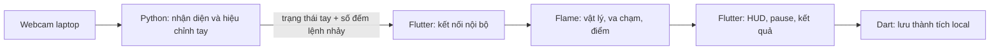

# GesturePlay — kiến trúc đã chốt: Flutter/Flame + Python nhận diện

Nền tảng: **Windows trên laptop**. Đây là kiến trúc hiện tại theo yêu cầu bắt buộc dùng Flutter. Các lựa chọn Pygame/FastAPI trong tài liệu thiết kế cũ là phương án trước khi chốt yêu cầu này.

| Phần | Công nghệ thực sự chạy |
|---|---|
| Menu, chọn độ khó, chuẩn bị tay, đếm ngược, HUD, tạm dừng, kết quả | Flutter / Dart |
| Robot, chuyển động, trọng lực, sinh gai/xu, va chạm, thời gian, điểm | Flame + Dart |
| Lưu kết quả và kỷ lục local | Dart, JSON ghi bất đồng bộ |
| Mở webcam, lật ảnh, Hand Landmarker, chụm/thả, hiệu chỉnh | Python + OpenCV + MediaPipe |
| Nối hai tiến trình trên cùng laptop | WebSocket tại `127.0.0.1:8765` |

Python không chạy luật chơi, không tính điểm và không vẽ cửa sổ game trong lệnh chạy chính. Mô hình chỉ được nạp khi người chơi chọn chơi bằng tay. Chế độ bàn phím hoạt động hoàn toàn trong Flutter/Flame.

## Một game đang triển khai

`runner` — Chạy vượt chướng ngại vật: ba độ khó, 120 giây chơi thực, +10 vượt một cụm gai, +20 mỗi xu. Chỉ nhảy khi chạm đất. Chơi lại tạo UUID local mới, đặt lại toàn bộ trạng thái. Mất tay/kết nối/quá hạn dữ liệu sẽ tạm dừng; có tay lại cần xác nhận tiếp tục. Giữ chụm chỉ phát một lệnh, phải thả rồi chụm cho lần tiếp theo.

## Giao thức nhận diện

Python chỉ lắng nghe loopback; không mở ra LAN/Internet. Chỉ một kết nối điều khiển tại một thời điểm. Dữ liệu JSON phiên bản 1 được gửi tối đa 20 lần/giây; ảnh JPEG preview 320 × 240 tối đa 8 lần/giây khi Flutter yêu cầu. Khi chơi, preview mặc định tắt. Không có video ghi lên đĩa.

Packet trạng thái gồm `epoch`, `seq`, `valid`, `ready`, `released`, `pinched`, `jump_id`, `jump_age_ms`, tâm bàn tay, tỷ lệ chụm, hai đầu ngón, tuổi kết quả và trạng thái camera/model. `jump_id` tăng khi có cạnh thả → chụm, được giữ qua các lần gửi. Flutter xử lý mỗi ID một lần; bỏ lệnh quá cũ và bỏ lệnh trong thời gian chuẩn bị/đếm ngược/pause. MediaPipe vẫn dùng timestamp monotonic tăng nghiêm ngặt. Tuổi ảnh và tuổi lệnh được tính bằng monotonic; `sent_at_ms` chỉ bổ sung ước lượng thời gian vận chuyển vì cả hai tiến trình dùng cùng đồng hồ Windows.

Các lệnh Flutter gửi: `start`, `stop`, `restart`, `preview`, `calibrate_open`, `calibrate_closed`, `calibrate_reset`, `shutdown`. Không có lệnh tải/chạy file Python tùy ý. Camera index/backend được kiểm tra; phải đóng worker cũ trước khi đổi camera. Nếu worker không đóng sạch, không mở thêm camera/model thay thế.

## Vòng đời

- Mở Flutter vào menu: chưa mở webcam hay Python.
- Chọn chơi bằng tay: Flutter thử nối dịch vụ hiện có; nếu chưa có, tự chạy `.venv/Scripts/python.exe main.py`.
- Chuẩn bị: camera và một HandLandmarker hoạt động; xem preview và hiệu chỉnh F1/F2.
- Về menu/kết thúc: gửi stop, dừng camera/model ngoài luồng vẽ; giữ kết nối nhẹ để bảo lưu hiệu chỉnh trong phiên.
- Chơi bàn phím: không cần Python hay webcam.
- Đóng Flutter: kết nối mất; Python tự dừng tài nguyên và thoát sau thời hạn idle nếu không có kết nối. Khi dispose bình thường, Flutter gửi shutdown cho tiến trình do mình mở.

## Lưu dữ liệu

Flutter lưu `flutter_app/data/runner_results.json`, tối đa 100 dòng, bảo lưu kỷ lục theo độ khó và kiểu điều khiển. Lưu bất đồng bộ, chống ghi trùng theo UUID local và có thử lại. Đây chưa phải kết quả được máy chủ xác nhận. Chưa triển khai tài khoản, xác thực, database tài khoản hoặc bảng xếp hạng online; các phần đó không được đưa vào Python nhận diện.

## Mã nguồn

- `flutter_app/lib/game/`: mô hình vật lý, controller cảnh, thành phần Flame.
- `flutter_app/lib/ui/runner_app.dart`: toàn bộ giao diện Flutter.
- `flutter_app/lib/services/`: cầu nối nhận diện, tìm đường dẫn dự án, lưu kết quả bằng Dart.
- `hand_service/server.py`: giao thức WebSocket nhận diện, hoàn toàn không import Pygame.
- `core/camera.py`, `hand_tracker.py`, `gestures.py`, `runtime.py`, `shared_state.py`: lõi nhận diện Python.
- `legacy_pygame_main.py`, `client/`, `ui/`: bản thử Pygame được giữ làm tham khảo; không chạy từ launcher mới.

Đọc `README.md` để chạy và kiểm tra môi trường Windows. Không coi kiểm tra headless hoặc mô phỏng 120 giây là bằng chứng về webcam thật hay hiệu năng trên màn hình thực tế.
